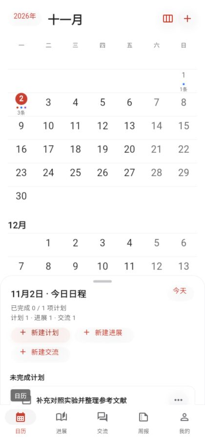
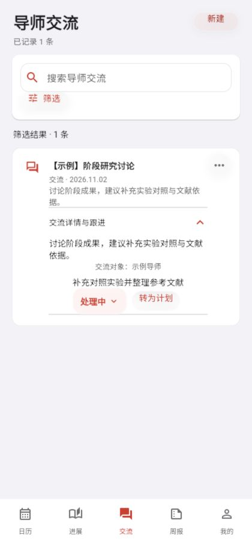
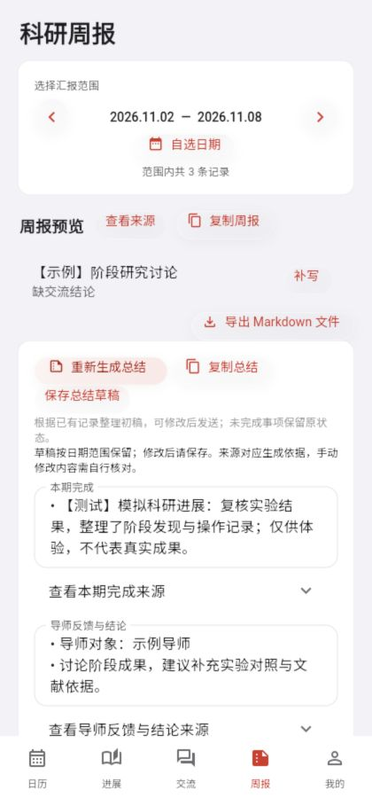
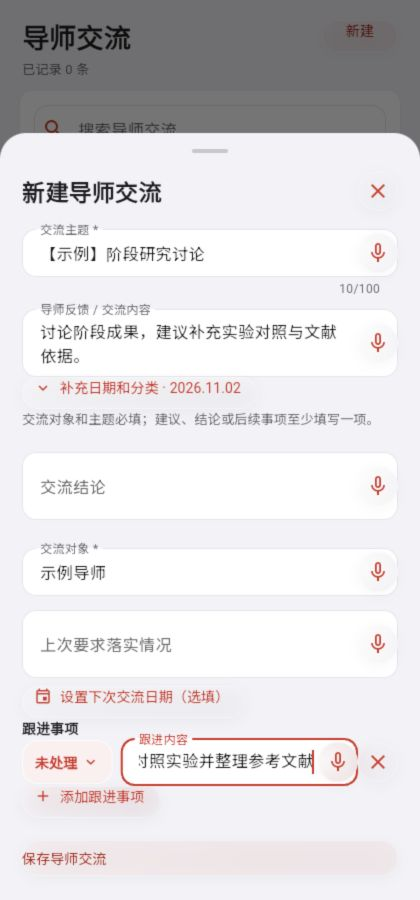

# 研历 YanLi · Android 原型

这是为科研场景重新编写的 Flutter 应用。首版面向个人离线使用，数据保存在当前设备，没有账号和云同步。

## 功能展示

以下为应用实际界面，记录内容均为虚构示例。

| 日历与计划 | 科研进展 | 导师交流与跟进 |
| :---: | :---: | :---: |
|  |  |  |
| 按日期查看计划、进展和交流。 | 记录科研工作，并支持搜索和筛选。 | 记录反馈，跟踪事项状态并转为计划。 |

| 周报总结 | 语音输入入口 |
| :---: | :---: |
|  |  |
| 根据已有记录生成可编辑的总结初稿。 | 点击输入框旁的麦克风进行语音输入；支持情况取决于设备和运行环境。 |

## 已实现

- 首页默认显示月历与所选日期的日程；可切换周视图，通过不同图标和文字图例区分计划、进展和交流，查看所选周计划数及完成率、返回今天。切换月份后若未选日期就收起，将显示该月第一天所在的周。
- 计划支持优先级、选填时间和完成状态，勾选完成会记录最近完成时间。
- 科研进展：突出标题和工作收获，问题、下一步及选填的投入时间可展开填写；成果、问题、下一步至少填写一项。支持关键词、日期范围与类型组合筛选。
- 导师交流：记录交流对象、主题、反馈、结论、上次要求落实情况和下次交流日期；可关联上次交流并回看原有事项，多条跟进事项分别维护未处理、处理中、已完成状态。跟进事项转为计划前可修改标题、选择日期或取消；删除关联记录时会说明对计划、交流和状态同步的影响。
- 每日提醒：默认每天 22:00 提醒记录科研进展，可在“我的”中调整时间或关闭；提醒由 Android 本地通知提供，需允许通知权限，系统省电策略可能造成延迟。
- 计划、进展和导师交流的输入框支持语音转文字：点击麦克风后说话，再点击“完成语音”识别，也可取消；结果可以修改后再保存。Android 使用设备端离线识别，要求 Android 12 或更高版本及可用的中文离线识别能力。Mac 的本机 Chrome 页面通过 sherpa-onnx 和 Paraformer 中文模型离线识别，每次最多 60 秒；音频不上传在线服务，本机识别临时文件在处理结束后删除。
- 选择周次或自定义日期范围，基于已有记录生成四章节汇报、按章节预览、逐条回查来源、复制 Markdown 文本和导出 Markdown 文件；汇报不会自动虚构内容。汇报也会按规则带入范围外的未完成事项和下周计划。
- 支持复制或通过安卓系统文件选择器导出 JSON 备份，包含有效记录、每日提醒开关与时间、回收站保留时间，不包含回收站内容、记录编辑草稿和总结草稿。可从文件或粘贴恢复，恢复前校验、预览、先复制或导出当前数据后确认覆盖；可选择是否恢复设置，旧备份没有设置时保留当前设置。恢复提醒仍需设备支持和通知权限；如设置恢复失败，界面会提示检查，已恢复的记录不回滚。新备份使用版本 4，旧版应用可能无法读取。清空需两次确认；保存未确认时表单保留供重试和复制草稿。数据无法读取时暂停修改并提供原始数据复制。
- 窄屏使用底部导航，平板和桌面宽屏使用侧边导航；支持系统字体放大。
- 所有平台（含 Web）启动时展示原学校启动图约 650ms，然后进入首页；系统开启减少动态效果时不播放切换动画。
- 回收站保留时间支持 3/7/30 天及自定义 1–3650 天正整数。缩短导致记录立即到期时需确认，取消或保存失败会保留原期限与记录。应用下拉菜单统一使用半透明圆角薄雾样式。

## 在这台电脑重新生成安卓体验包

已将 Flutter、Android SDK、Java 和 Gradle 的开发工具放在 `~/Developer/yanli-tools`。在项目目录运行：

```bash
./tools/build_android.sh
```

首次运行可能需要联网下载依赖。生成的 APK 同时会复制为项目目录下的 `研历YanLi-安卓体验版.apk`。它是课程测试版，使用调试签名，适合安装体验；如果要上架应用商店，需要配置正式签名。该版本要求 Android 7.0（API 24）或更高。

## 运行

需要 Flutter 3.38.1 或更高版本、Android Studio 和 Android SDK。连接安卓手机或启动安卓模拟器，在本目录运行：

```bash
flutter pub get
flutter run
```

生成 APK：

```bash
flutter build apk --release
```

生成文件通常位于 `build/app/outputs/flutter-apk/app-release.apk`。如果你们要正式发布，需要另行设置应用签名；开发调试也可以使用 `flutter build apk --debug`。

也可以用 `flutter run -d chrome` 在浏览器中预览界面，但该命令不会自动启动本机语音服务；需要语音输入时，请另开终端运行 `./tools/start_voice.sh`，或使用下方的 `Run Flutter Web` 任务、F5 启动配置。浏览器数据与手机数据各自保存在当前设备，不会自动同步。

在 VS Code 中也可以通过“终端 → 运行任务 → Run Flutter Web”启动。若要绑定快捷键，打开“首选项: 打开键盘快捷方式(JSON)”，添加：

```json
{
  "key": "cmd+alt+shift+r",
  "command": "workbench.action.tasks.runTask",
  "args": "Run Flutter Web"
}
```

绑定后按 `⌘⌥⇧R` 即可自动获取依赖并在 Chrome 中运行。启动任务使用 `~/Developer/yanli-tools` 下的 Flutter 和 Pub 缓存。

### 在这台 Mac 上运行安卓模拟器

Android SDK 和名为 `YanLi_Android` 的 Android 15 虚拟设备配置在 `~/Developer/yanli-tools/android` 和用户主目录下。安装 VS Code 的 Flutter 扩展后，使用“运行和调试”选择 **研历 Android 模拟器**，按 F5 会启动模拟器并运行应用。首次启动和编译可能需要几分钟；如果此前 VS Code 未发现模拟器，可执行“开发人员: 重新加载窗口”后再试。模拟器的数据与 Chrome 的数据相互独立，需要通过“我的”中的备份功能手动导入。

这台 Mac 的虚拟设备已设置为 90 Hz，并在通过 VS Code 启动时使用 Apple GPU 和 Guest ANGLE；首次修改设置后请重新加载 VS Code 窗口。90 Hz 是目标刷新率，实际帧率仍受模拟器和调试模式的性能影响。如果出现黑屏或图形异常，请先关闭模拟器，在 `~/.android/avd/YanLi_Android.avd/config.ini` 中把 `hw.gpu.mode` 改为 `auto`，并删除本项目 VS Code 设置 `dart.env` 中的 `ANDROID_EMULATOR_FEATURES`，然后重新加载 VS Code 窗口再启动。此操作不会清除模拟器数据。

在模拟器的“我的 → 每日提醒”中开启提醒并允许系统通知权限，可将提醒时间设为几分钟后进行测试。通知使用非精确调度，实际出现时间可能晚于设定时间；模拟器需要保持运行。当前虚拟设备使用标准 Android 系统镜像，未包含离线中文语音识别服务；如需测试语音，可使用符合条件的安卓真机，浏览器语音和安卓系统语音是两套独立实现。

### Mac 浏览器离线语音与 F5 启动

安装 VS Code 的 Flutter 扩展（`Dart-Code.flutter`），打开项目目录，按 F5 并选择“研历 Chrome（本机离线语音）”。启动前会自动运行本机语音服务；也可以运行 `./tools/run_web.sh` 同时启动语音服务和 Chrome。第一次点击麦克风时允许 Chrome 的麦克风权限；macOS 如有提示，也需要允许 Chrome 访问麦克风。点击输入框旁的麦克风即可开始听写，文字会在说话期间分批显示并自动修正；检测到约 3 秒停顿后自动结束并确认结果，无需点击“完成语音”。每约 0.8 秒提交一次本机识别，显示有短暂延迟，仍可手动提前完成；取消会恢复本次听写前的文字。开始听写会先释放键盘焦点，避免浏览器在切换只读状态后无法继续打字；听写结束后可重新点击任意输入框继续键盘编辑。每次最多 60 秒，达到时限自动识别。

本机语音使用 [sherpa-onnx](https://github.com/k2-fsa/sherpa-onnx) 的原生 Node.js 接口和 FunASR Paraformer 中文模型，不再依赖 Whisper。此电脑已安装依赖并下载模型。其他 Mac 安装 Node.js 后，在项目目录依次运行 `npm ci --prefix tools` 和 `node tools/setup_voice.mjs --paraformer`；安装脚本下载模型并校验 SHA-256。模型位于 `~/Developer/yanli-tools/voice/paraformer/`，常驻内存并明确按中文识别；识别音频仅在内存中处理，不写入录音文件。模型来源为 https://huggingface.co/csukuangfj/sherpa-onnx-paraformer-zh-2023-09-14 。录音使用 AudioWorklet 在音频线程中采集，并由浏览器重采样为 16kHz，启用麦克风自动增益和降噪，降低主线程卡顿丢音与低音量截断的影响。运行 `npm test --prefix tools` 可验证录音格式与静音处理；可选安装原 SenseVoice 模型后运行 `node tools/compare_voice.mjs` 比较两个模型的受控样本识别结果。6 段合成中文样本共 108 字，SenseVoice 字符错误数为 5，Paraformer 为 2；该结果仅用于回归比较，不代表真人录音准确率。

语音服务仅监听 `127.0.0.1:18768`，只接受本机 `http://localhost` 或 `http://127.0.0.1` 网页调用；无需外部 API 或安卓模拟器。单独使用静态网页预览时，另开终端运行 `./tools/start_voice.sh`。在 VS Code 的任务终端停止该任务即可关闭语音服务。

各浏览器、浏览器配置以及不同站点地址（含端口）的本地数据独立，因此用户窗口可能显示0条，而 agent 预览页显示12条。可在“我的 → 测试数据 → 添加测试进展”，或进展列表为空时点击“添加测试进展”，确认后向当前窗口追加12条【测试】模拟记录；成功后显示实际新增数量并打开进展页、重置筛选。不会覆盖已有记录或清空回收站，保存失败可重试。示例覆盖5种科研类型和过去11天至今天，正文、问题、下一步及投入时间均为模拟。固定命名空间ID在记录和回收站中去重，重启后仍有效；此前 agent 页若用了其他ID，旧示例可能并存，不按标题删除或修改旧数据。应用不会在启动时自动注入测试数据，也不共享浏览器存储或使用服务端。

如需用静态网页预览最新修改，先运行 `flutter build web`。如果此目录下已有 `build/web`，也可以不安装 Flutter，直接在此目录运行：

```bash
python3 -m http.server 18765 --bind 127.0.0.1 --directory build/web
```

然后用本机浏览器打开 `http://127.0.0.1:18765/`。关闭终端或按 Ctrl+C 后，预览服务会停止。

## 周报总结初稿

在“周报”选择日期后点击“生成总结”，按已有汇报记录整理为本期完成、导师反馈与结论、问题与待支持事项、下一步计划四部分。各部分可以编辑和查看来源，支持复制总结。修改后点击“保存总结草稿”，草稿按日期范围保存在当前设备；重新生成需确认覆盖。当前版本使用确定性规则归集与去重，没有接入语言模型或自动润色，不会补写未记录的成果或把未完成事项改成已完成。切换日期或离开页面前请保存修改。

## 项目结构

- `lib/main.dart`：页面、交互和本地存储。
- `lib/progress_search.dart`、`lib/report_preview.dart`：进展筛选与汇报预览界面。
- `lib/domain.dart`、`lib/range_report.dart`：记录结构、日期、备份和汇报生成逻辑。
- `test/`：数据规则和界面交互测试。

这是课程项目原型；尚未提供登录、多人协作、服务端或真实导师消息推送。卸载应用可能清除设备上的数据，请先备份。

备份兼容：新版可以读取版本 1 的旧备份，版本 2 备份包含导出时间、设置和新增导师交流字段。旧版应用不能读取版本 2 备份，也无法保留三态跟进和关联字段；升级前请另存原始备份，不要用旧版编辑新版数据。汇报中的“当前未完成”按目前状态显示，不代表历史日期的完成状态。
